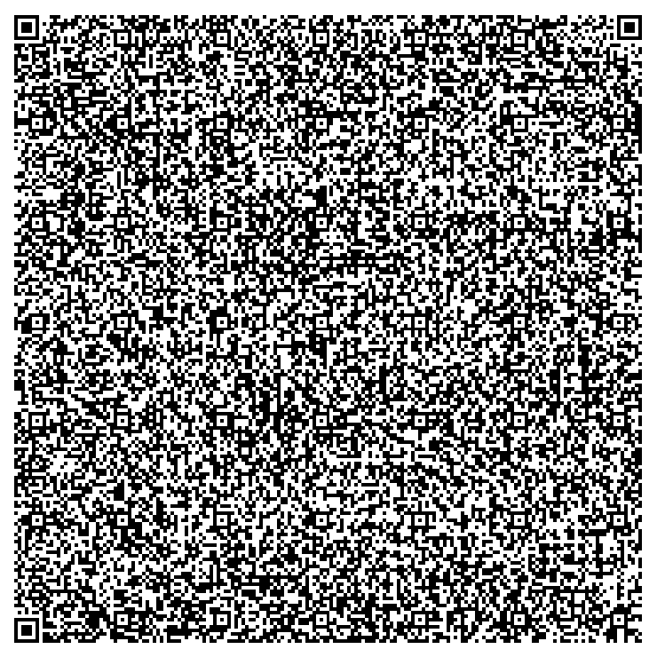

# A gnuplot script that plots a QR code of itself

A gnuplot script that plots a QR code whose payload is the script itself.



| File | Contents |
| --- | --- |
| `GnuplotQrCode.lean` | the instance of the engine and the proof |
| `encoder-source.gp` | the readable gnuplot QR encoder, one statement or block per line |
| `gen_encoder.py` | joins the source into the one-line library `encoder.gp.inc` |
| `encoder.gp.inc` | the library embedded in the script (a fragment, not a script) |
| `check.mjs` | plots the files with gnuplot and decodes them with jsQR and ZXing |
| `qr-code.gp` | the quine, written by `lake exe quine` |
| `qr-code.png` | the plot above, from `gnuplot`'s png terminal |

## The format

The QR code is version 40 (177 × 177 modules), error correction level L, byte mode, with the mask
fixed to 0, the same as the PostScript QR quine. Its capacity is 2,953 bytes.

## The file

`qr-code.gp` is 2,214 bytes on one line, with the shape of the SVG and PostScript quines:

```
v='s="v=".sprintf("%c",39).v.sprintf("%c",39).";eval v";n=177;…';eval v
```

- **The mechanism.** It binds its code to `v` and runs it with `eval`.
- **The code.** It sets `s` to the file, rebuilt from `v`, then runs the encoder on `s`.
- **No `'` in the code.** The code sits in a `'…'` literal, so it can't contain `'`, and it writes
  `'` as `sprintf("%c",39)`.
- **One line.** gnuplot string literals can't span lines.

**How the encoder works.**
- **Arrays** hold the matrix, the codewords and the Reed–Solomon generator. GF(256) products are a
  recursive gnuplot function.
- **No `ord`.** gnuplot has no character-code function, so a character's code is its position,
  found with `strstrt`, in a table of the printable characters built with `sprintf("%c",i)`.
- **Procedures.** gnuplot functions can only compute values, so the routines that write to arrays
  are strings run with `eval`: set a module, draw a finder pattern, fill a column pair.
- **Drawing.** The matrix is printed into a datablock and plotted
  `with image pixels`, with margins and ranges set so that the plot is exactly the symbol and its
  4-module quiet zone.

**Viewing.** The script sets no terminal, so it plots wherever gnuplot is set to plot.
- **In a window:** `gnuplot -p qr-code.gp`, with a gnuplot that has one, such as `gnuplot-qt`.
- **To a file:**

  ```sh
  gnuplot -e "set term png size 740,740; set output 'qr.png'" qr-code.gp
  ```

  At 740 × 740 pixels a module is exactly 4 pixels.

## The development

- **The file model** is `lean/QuineEngine/GpScript.lean`.
  - **Files** have the shape `v=LIT;eval ARG`, where `ARG` is `v` or a literal.
  - **Literals** are `'…'` (printable ASCII except `'`) or `"…"` made of octal escapes `\ooo`.
    The octal form is used by the quotation.
  - **The code** is `s=E;` followed by the library, where `E` concatenates `"…"` literals, `v` and
    `sprintf("%c",n)`.
- **The QR code** is the abstract `Codec` of `lean/QuineEngine/Barcode.lean`, as for the other QR
  quines.
- **Result.** `quine_correct (Q : Codec) : 2953 ≤ Q.C → (system Q).IsQuine quine`. It depends
  only on `propext` and `Quot.sound`.

**What is trusted:**
1. gnuplot runs files of the modelled shape as modelled;
2. `encoder.gp.inc` implements a codec of capacity 2,953 on printable ASCII.

## Testing

Tested with Node.js 18.19.1 and npm 9.2.0, the npm packages jsqr 1.4.0, @zxing/library 0.21.3 and pngjs 7.0.0, which `npm install` installs at the versions pinned in `package-lock.json`, and gnuplot 6.0 patchlevel 0. From this folder:

```sh
npm install
node check.mjs
```

The script plots each file with gnuplot's png terminal and decodes the image with jsQR and with
ZXing:
- **The encoder.** The quotation files for random texts up to the capacity decode correctly, and
  a text above capacity is rejected.
- **The quine.** The plot of `qr-code.gp` decodes to the file itself.

To change the encoder, edit `encoder-source.gp`, run `python3 gen_encoder.py`, then rebuild and
rerun the checks.
