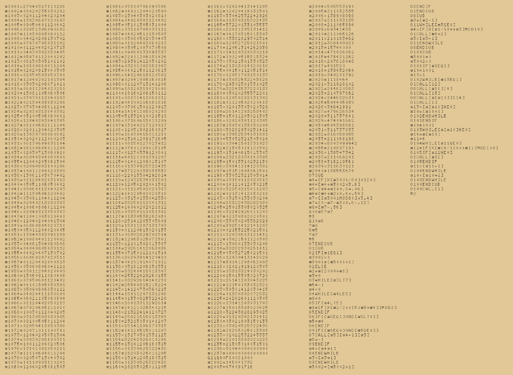
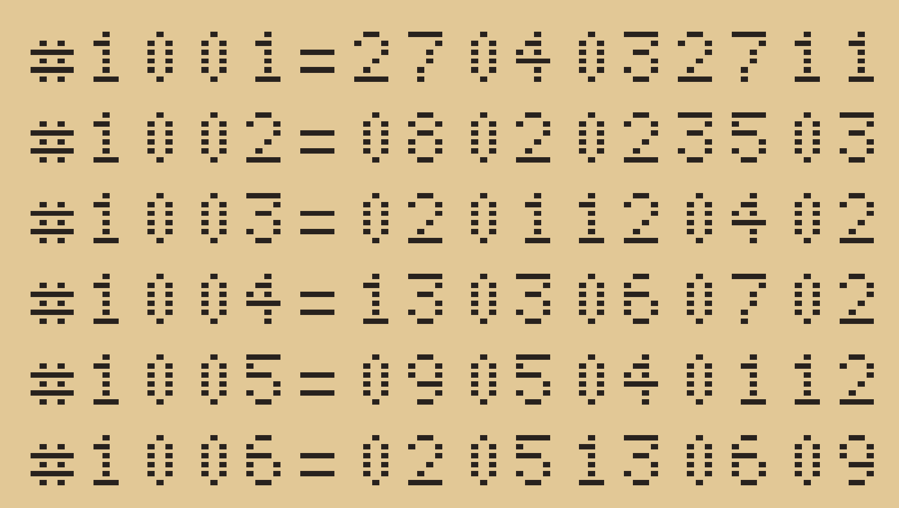

# A G-code program that laser-cuts a stencil of itself

A LinuxCNC G-code program that, run on a laser cutter, cuts its own source out of a sheet as
stencil lettering.

| File | Contents |
| --- | --- |
| `NgcStencil.lean` | the instance of the engine, the alphabet, and the proof |
| `stencil.ngc.inc` | the G-code library embedded in the program (a fragment, not a program) |
| `gen_stencil.py` | generates `stencil.ngc.inc` from the SvgText font |
| `ngcsim.py` | a simulator for the subset of LinuxCNC G-code that the program uses |
| `check.py` | runs the files in the simulator and reads the cuts back |
| `render.py` | draws the preview images below from the simulated cuts |
| `stencil.ngc` | the quine, written by `lake exe quine` |
| `stencil.pbm` | the stencil that the Lean model predicts, written by `lake exe quine` |
| `stencil.png`, `closeup.png` | the preview images |

## The stencil

**Letters.** Each character is a 5 × 7 glyph of the font of the SvgText quine.
- **Bars.** Each run of pixels in a glyph row is cut as one bar, so a letter is a stack of
  horizontal slots.
- **Why nothing falls out.** The uncut strips between rows run unbroken across every letter. So
  the insides of letters such as `0`, `8` and `B` stay attached, as in a stencil font.

**Sizes.**
- A pixel is 0.6 mm and a bar 0.36 mm high, with 0.24 mm strips between bars.
- A cell is 3.6 × 5.4 mm, and a line holds at most 32 characters.
- Lines run 80 to a column, in columns 120 mm apart.

**The sheet.** The quine's 362 lines fill 5 columns, a sheet of about 600 × 432 mm, cut as
46,133 bars. The thin strips suit card or thin plywood. To scale the stencil, change `PITCH` in
`gen_stencil.py`, then rebuild and rerun the checks.



The top-left corner, where the program begins:



To redraw the images after the file changes, run `python3 render.py`. It needs Pillow 13.0.0, from
the root `requirements.txt`: run it with `.venv/bin/python`.

## The file

`stencil.ngc` is 6,624 bytes of LinuxCNC G-code (RS274NGC):

```
#1001=27040327110226
#1002=08020235080202
...
#1237=00000000000000
G21G90F600S1000
#2002=145041732
...
O100CALL[1]
M2
```

- **The data block.** G-code has no strings, so the program stores its code in the parameters
  #1001, #1002, …, up to a zero.
  - Each parameter holds seven two-digit codes, where a code is one more than the character's
    position in the alphabet, and `00` is padding.
  - The data block fits in #1001–#1999, clear of the library's parameters and of LinuxCNC's
    system parameters. So it holds at most 6,986 characters, and the quine uses 6,624.
- **The code.**
  - It holds the glyphs of the alphabet in #2002–#2040.
  - It defines subroutines that cut one bar (`O7`), one character (`O1`) and a fixed-width
    number (`O8`).
  - The main subroutine `O100` cuts the text stored in the data block. In mode 1 it first cuts
    the data lines themselves, digit by digit.
- **The laser.** It is switched with `M3` and `M5` around each bar, which is cut with `G1`.
- **The alphabet.** The program uses 40 characters: newline, digits, `# = [ ] . - + * /`, and
  the capitals it needs. It has no spaces, because LinuxCNC ignores them.

## The development

- The file model is `lean/QuineEngine/NgcScript.lean`.
  - **Files** are a data block followed by code of the form `ENC O100CALL[m]⏎M2`.
  - **The data block.** `parseFile_dataBlock` proves that the data block of a text reads back to
    the text. The fixed-width numbers make this a statement about digit lists, with no decimal
    arithmetic.
- **The font.** `NgcStencil.lean` uses the glyphs of `lean/QuineEngine/Quines/SvgText`, which
  are proved to decode to their characters.
- **The theorem.** It is the same minimal fixed point theorem as for the other quines.
  - **No eval.** G-code has none, so this is the classic data + code form:
    `sub c x = dataBlock x ++ c`.
  - **The template** is the code in mode 1, which cuts `dataBlock x ++ x`.
- **Result.** `quine_correct : system.IsQuine quine`. It has no hypotheses and depends only on
  `propext` and `Quot.sound`.

**What is trusted:**
1. LinuxCNC runs the data assignments and the library as modelled. In particular, it must
   decode the codes exactly: the values stay below 10¹⁴, where floating-point division and `MOD`
   are exact for these digits.
2. The library cuts the glyphs of the text that its mode shows.

**Running it on a machine.** Parameters #31–#5000 keep their values between programs in a
LinuxCNC session. The zero line that ends the data block stops the program from reading leftovers
from an earlier run.

## Testing

Tested with Python 3.12.3, with no extra packages. From this folder:

```sh
python3 check.py
```

**The simulator.** `ngcsim.py` stands in for LinuxCNC, which has no package for this system. It
is written from LinuxCNC's documentation, and it rejects anything outside the subset it knows
instead of guessing.

The script runs each file in the simulator and collects the bars cut while the laser is on.
- **The library.** The quotation files for several texts, including the whole alphabet and more
  than 80 lines, cut stencils that read back to the texts.
- **The quine against Lean.** The pixels cut by `stencil.ngc` are exactly `stencil.pbm`, Lean's
  prediction.
- **The quine against itself.** The stencil read with the font gives back the source.
- **The stencil property.** Every cut is a closed bar inside its glyph, and no two bars of a row
  touch.

**What the reading cannot show:** cells without bars are spaces, and a final line break would be
invisible. The program has neither.
