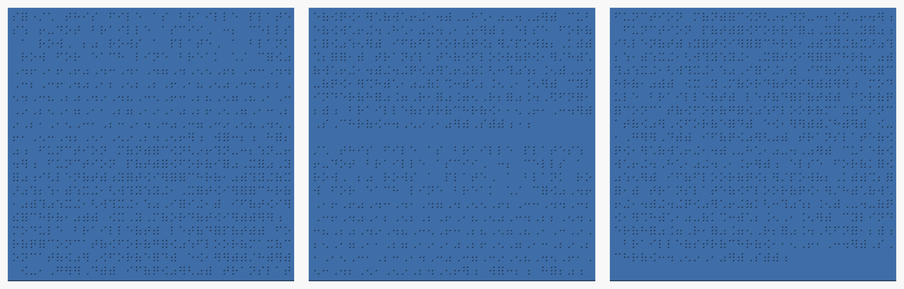
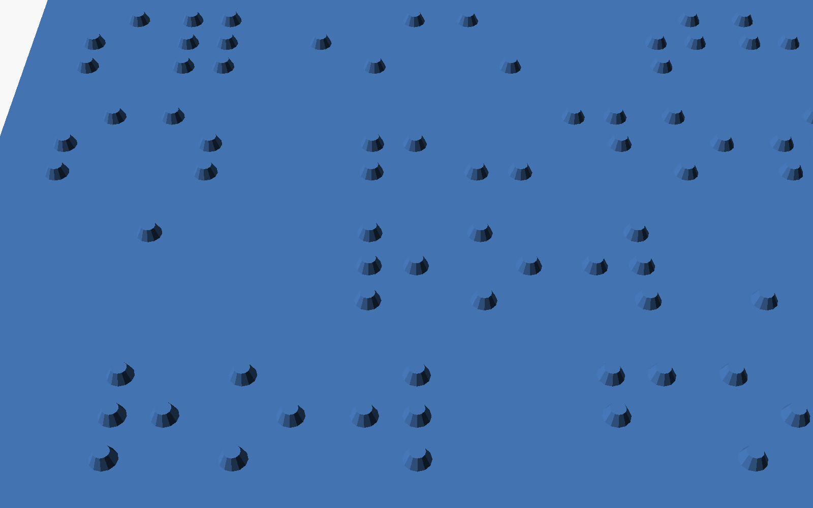

# An OpenSCAD model of itself in braille

An OpenSCAD file whose 3D model is a set of braille plates that emboss the file's own source. A
3D printer turns it into a physical object that can be read by touch.

| File | Contents |
| --- | --- |
| `ScadBraille.lean` | the instance of the engine, the braille code, and the proof |
| `braille.scad.inc` | the OpenSCAD library embedded in the file (a fragment, not a model) |
| `check.py` | evaluates the files with OpenSCAD and reads the plates back, against a table from liblouis |
| `braille.scad` | the quine, written by `lake exe quine` |
| `braille.txt` | the reading of the plates that the Lean model predicts, written by `lake exe quine` |
| `render.py` | renders the preview images below with OpenSCAD |
| `plates.png`, `closeup.png` | the preview images |

## The format

The plates carry 6-dot Braille ASCII, the code of braille embossers and `.brf` files.
- **Cells.** Braille ASCII has 64 cells and no case, so the file uses exactly 64 characters:
  space to `@`, `[ \ ] ^ _`, and the lower-case letters, which are read as lower case.
- **Fitting OpenSCAD into it.** The program avoids capitals, `{ | } ~` and the backtick:
  - its module body is a single statement;
  - top-level shapes are unioned implicitly;
  - `pow` replaces `^`.
- **Rows** hold 32 cells, and a plate holds 20 rows. Rows are read left to right and top to
  bottom, plate after plate.
- **Line breaks.** A row followed directly by another row continues the same line. A blank row is
  a line break.
- **Sizes** follow common tactile signage practice:
  - dots are cones with a 1.5 mm base, 0.6 mm high, 2.5 mm apart;
  - cells are 6 mm apart, rows 10 mm;
  - plates are 196 × 204 × 1.6 mm, each for one print bed.

## The file

`braille.scad` is 1,838 bytes on two lines: the data, then the code. Its model has 3 plates and
5,043 dots.

```
s="/* this file as braille plates: ... */ c=[0,46,...]; ... braille(str(chr([115,61,34]),s,chr([34,59,10]),s));";
/* this file as braille plates: ... */ c=[0,46,...]; ... braille(str(chr([115,61,34]),s,chr([34,59,10]),s));
```

- **No eval.** OpenSCAD can't run a string, so this is a classic data + code quine: the code
  appears twice, once as the string `s` and once as code.
- **One line of code.** OpenSCAD's lexer drops raw newlines inside a string literal, so the
  code is a single line.
- **No `"` in the code.** It writes `s="` and `";` with `chr([…])`.
- **Viewing.** Open the file in OpenSCAD and preview it (F5). Rendering to STL (F6) unions the
  dots with the plates, which takes a while.

The three plates, rendered by OpenSCAD. The blank row on the second plate is the line break
between the data and the code:



The top-left corner of the first plate, where the text begins: `s` (dots 2-3-4), `=` (dots 1–6)
and `"` (dot 5):



To redraw the images after the file changes, run `python3 render.py`. It needs OpenSCAD 2021.01 and
Pillow 13.0.0, from the root `requirements.txt`: run it with `.venv/bin/python`.

## The development

- The file model is `lean/QuineEngine/ScadScript.lean`.
  - **Files** have the shape `s="…";`, a newline, and the code.
  - **Literals** may contain `\xHH` escapes, which the quotation uses.
  - **The code** is the library followed by `braille(E);`, where `E` is `s`, `chr([…])`, or
    `str(…)` of these.
- `ScadBraille.lean` defines Braille ASCII (`cell`) on the alphabet and its inverse (`uncell`),
  from the table in `lean/QuineEngine/Braille.lean`.
- **The theorem.** It is the same minimal fixed point theorem as for the other quines. Because
  OpenSCAD has no eval, substitution is `sub c x = s="x";⏎c` with no shortcut for `c = x`.
- **Result.** `quine_correct : system.IsQuine quine`. It has no hypotheses and depends only on
  `propext` and `Quot.sound`.

**What is trusted:**
1. OpenSCAD evaluates files of the modelled shape as modelled;
2. the module `braille` in `braille.scad.inc` builds plates that read, as described above, as
   `render` of its argument, and the library leaves `s`, `str` and `chr` alone.

## Testing

Tested with Python 3.12.3 and OpenSCAD 2021.01. From this folder:

```sh
python3 check.py
```

OpenSCAD evaluates each file to its CSG tree, which lists every plate and dot. The script reads
the dots back as braille. The reference is a NABCC table in `check.py`, copied from the table
`en-nabcc.utb` of [liblouis](https://liblouis.io) 3.29.0; without dots 7 and 8, it is Braille
ASCII:
- **The library.** The quotation files for several texts read back correctly. The texts include
  all 64 characters, wrapped rows and blank lines.
- **The quine against Lean.** The plates of `braille.scad` read as `braille.txt`, the prediction
  of the Lean model.
- **The quine against the table.** The reading is the Braille ASCII of the source, and it reads
  back to the source.

**What the reading cannot show:** cells without dots are spaces. So a text whose line ends in a
space, or that has a row of nothing but spaces, would not read back. The quine has neither.
