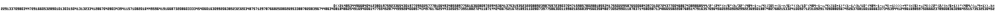

# A formula that plots itself

An inequality in `x` and `y` whose set of solutions in ℕ² is a picture of the inequality, constant
included.



| File | Contents |
| --- | --- |
| `SelfPlottingFormula.lean` | the formulas, the typesetting, the instance of the engine, and the proof |
| `font.txt` | the 3×5 pixel font, read by both Lean and `check.py` |
| `check.py` | an independent check in Python, which also draws `plot.png` |
| `formula.txt` | the formula, written by `lake exe quine` |
| `plot.pbm` | Lean's own evaluation of the formula, written by `lake exe quine` |
| `plot.png` | the same plot as an image, written by `check.py` |

## The formula

`formula.txt` has two lines:

```
0<(214853449668…/2^(24*(y/6*(k/32^(484-1-x/4)%32)+…))%2*(2/(y/6+1))*(484/(x/4+1)),k=
839674486340…452
```

It denotes the points `(x, y)` of ℕ² with `0 < E(x, y, k)`, where `E` is the term on the first
line and `k` is the 484-digit number on the second.
- Terms use `+ - * / % ^` on the natural numbers. `-` is truncated subtraction, `/` is floor
  division, and `^` binds tightest.
- The first line is 322 characters long and the whole formula 807.

The plot is compared with the text by typesetting:
- each character is a 3×5 glyph from `font.txt`, placed in a 4×6 cell;
- both lines are right-aligned at column `W = 484`;
- the second line is at the bottom, and `y` points up.

The plot of the formula is exactly the typesetting of `formula.txt`. It has 7,947 black pixels,
and the formula is false everywhere else in ℕ².

**Comparison with Tupper's formula.** Tupper's self-referential formula draws itself only in the
strip `k ≤ y < k + 17`, and its 543-digit `k` is supplied from outside and not drawn. Here `k` is
part of the formula and appears in the picture, and the formula is plotted over the whole
quadrant.

## How it works

- **The constant encodes the first line.** Read as a base-32 numeral, most significant digit
  first, with each character's code as a digit, the first line is the number `k`. So cell `p` of
  the top line, counted from the right, holds code `⌊k/32^p⌋ % 32`.
- **The constant draws itself.** Cell `p` of the bottom line is decimal digit `p` of `k`,
  counted from the right, which is `⌊k/10^p⌋ % 10`. It is blank once `⌊k/10^p⌋ = 0`.
- **Right-alignment avoids lengths.** Counting cells from the right makes every character a
  constant-offset digit extraction, so the formula never needs the digit count of `k`.
- **The font is a number.** `F` stores the glyphs: pixel `(c, r)` of the glyph with code `d` is
  bit `24d + 4r + c`. The formula looks the pixel up as `⌊F/2^(24d+4r+c)⌋ % 2`.
- **Cut-offs.** The factors `2/(y/6+1)` and `484/(x/4+1)` vanish above the two lines and to the
  right of the text.

## The development

- **Texts and pictures.**
  - Texts are `List Char`; pictures are `ℕ → ℕ → Bool`.
  - `typeset` is the rendering map on well-formed texts (`wf`): two nonempty lines of alphabet
    characters, each of at most `W` characters.
  - `decode` reads a picture back cell by cell. It is the scanning map, and `decode_typeset`
    proves that it inverts typesetting.
  - Facts about the font (codes, and that every glyph decodes to its character) are checked by
    `decide +kernel`.
- **Formulas.**
  - `Term` and `Term.eval` give the term language and its semantics.
  - A recursive-descent parser (`pSum` and friends) and `parseFormula` read a formula.
  - `plot t k` is the set of points where `0 < t(x, y, k)`.
- **Numerals.**
  - `num` reads a line in base 32; `numN_digit` and `num_digit` extract its digits.
  - `dec` prints in decimal. `cellCode_dec` gives the decimal digits counted from the right, and
    `parseDec_dec` reads them back.
- **The instance.**
  - **Substitution.** `sub c x` is the formula with first line `c` and constant `num x`.
  - **Template.** `tmplText` is the first line shown above, and `tmplTerm` is its term.
  - **Quotation.** `quote t` plots an arbitrary well-formed text. Its constant interleaves the two
    lines: base-32 digit `2p + L` is cell `p` of line `L`.
  - **Plot lemmas.** `plot_tmpl` and `plot_e2` show that the template and the quotation plot what
    they should. Both reduce to `plot_frame`, which compares the plot with the typesetting cell
    by cell.
- **Result.** `quine_correct : system.IsQuine quine`, obtained from `Diagonal.isQuine`.
  - There is no capacity bound. The side condition `okB tmplText` (both lines fit within `W`) is
    decided.
  - The theorem depends only on `propext` and `Quot.sound`; in particular it does not use the
    axiom of choice.

This quine uses the engine's minimal form: a diagonal datum (`Diagonal`, Theorem 3.4 of the
paper), with the template property proved for every admissible `x`, and an honest quotation. It
does not provide a uniform template structure (`Templates`).

## Checking

Tested with Python 3.12.3, with no extra packages. From this folder:

```sh
python3 check.py
```

It parses and evaluates `formula.txt` with its own parser and evaluator, independent of Lean, and
checks four things:
1. the plot equals Lean's `plot.pbm`;
2. the plot equals the typesetting of `formula.txt` with `font.txt`;
3. reading the plot back gives `formula.txt`;
4. the formula is false at sampled points far outside the text.

Then it writes `plot.png`.
